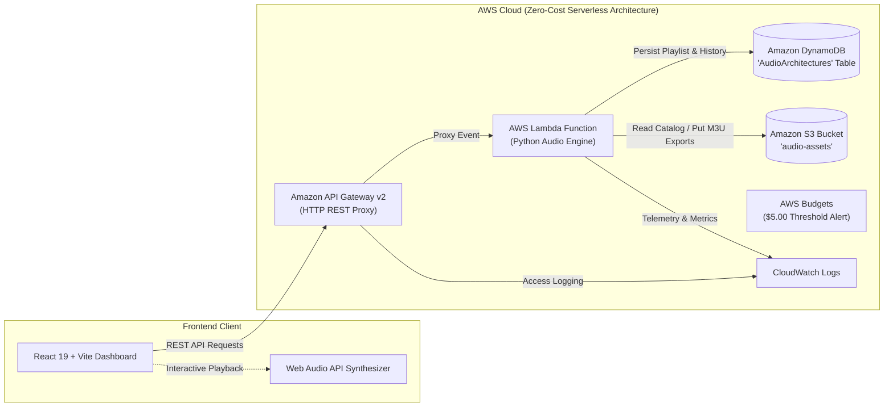

# Audio Architecture & Playlist Structuring API

[](.github/workflows/ci-cd.yml)
[](https://aws.amazon.com/)
[](https://www.terraform.io/)
[](https://aws.amazon.com/dynamodb/)
[](https://aws.amazon.com/lambda/)
[](https://www.python.org/)
[](https://react.dev/)

A cloud-based **Audio Architecture System** engineered to mathematically structure continuous, multi-genre audio playlists tailored to explicit energy curves \(E(t)\). Developed for the **Cloud Computing & DevOps Mini-Project (5th Semester, Academic Year 2026-27)** under the supervision of **Dr. Soumya Nandan Mishra**.

---

## 👥 Student & Supervisor Details
- **Department:** School of Computer Engineering
- **Semester:** 5th Semester &bull; **Section:** B &bull; **Batch:** B2 &bull; **Team:** 6 &bull; **Academic Year:** 2026-27
- **Supervisor:** **Dr. Soumya Nandan Mishra**, School of Computer Engineering

### Team Members
| Student Name | Registration Number | Primary Domain & Contribution |
| :--- | :--- | :--- |
| **Dipankar Banerjee** | `240905618` | Cloud Architecture, Terraform (IaC), DynamoDB, AWS Budgets & CI/CD |
| **Pratham Shah** | `240905614` | Audio Architecture Engine, Energy Profiling, Harmonic Camelot Wheel & Optimizer |
| **Vaibhav Bhatia** | `240905504` | Full-Stack Integration, React UI Dashboard, SVG Visualizer, Web Audio Synthesizer |

---

## 📋 Compliance with Mini-Project Guidelines

| Guideline | Requirement | Project Implementation |
| :--- | :--- | :--- |
| **Guideline 1** | Team size 2-3 from same batch | **3 members** from Batch B2, Team 6 (Dipankar, Pratham, Vaibhav). |
| **Guideline 2** | Approved Synopsis | Fully follows the approved **Audio Architecture & Playlist Structuring API** synopsis. |
| **Guideline 3** | Public cloud provider | Built on **Amazon Web Services (AWS)** serverless infrastructure. |
| **Guideline 4** | At least 4 cloud managed services + IaC + CI/CD | **5 AWS Managed Services**: (1) AWS Lambda, (2) Amazon API Gateway, (3) Amazon DynamoDB, (4) Amazon S3, (5) AWS Budgets & CloudWatch; **Terraform** (IaC); **GitHub Actions** (CI/CD). |
| **Guideline 5** | Cloud Computing & DevOps focus | Serverless cloud design, zero-cost architecture, declarative IaC, automated CI/CD pipeline. |
| **Guideline 6** | Technical Design Document & Demo | Complete [Technical Design Document](docs/TECHNICAL_DESIGN_DOCUMENT.md) + live demo environment + 21 unit tests. |
| **Guideline 7** | Budget Caution & Cloud Budget Alerts | Provisioned automated **AWS Budgets Alert** resource (`$5.00` limit with 80% & 100% email notifications). |

---

## 🏗️ System Architecture



---

## 🚀 4 Foundational Modules (From Synopsis)

1. **User Interface Module:**
   - React web dashboard allowing users to input target duration, pick genres, map desired energy curves, and fine-tune mathematical weights.
   - Interactive **SVG Energy Visualizer** plotting Target Curve vs Actual Track Step Trajectory with hover telemetry cards.
   - Built-in **Web Audio API Synthesizer** for real-time chord motif playback and full continuous sequence preview.

2. **Audio Architecture Engine (API):**
   - Serverless Python engine on AWS Lambda calculating continuous energy profiles:
     - *Pomodoro Focus Peak* (warmup, sustained peak, cool-down resolution)
     - *Continuous Ascent*
     - *Decompression Glide*
     - *Interval Wave*
     - *Steady-State Flow*
     - *Sunset Transition*
     - *Custom User Spline*
   - Modulo-12 **Camelot Wheel harmonic key compatibility** matrix.
   - **Multi-Objective Beam Search Optimizer** ensuring smooth BPM jumps (with octave doubling/halving recognition) and multi-genre acoustic bridging.

3. **Data & Storage Module:**
   - **Amazon DynamoDB** on-demand NoSQL table (`AudioArchitectures`) storing finalized tracklists, transition scores, and user generation history.
   - **Amazon S3** object storage storing catalog datasets and exported bundles with a 30-day lifecycle expiration rule.

4. **Export & Integration Module:**
   - One-click export into:
     - **Extended M3U8** (`.m3u` file with rich `#EXTINF`, `#EXT-X-BPM`, `#EXT-X-KEY`, and `#EXT-X-ENERGY` tags for VLC, Rekordbox, Serato, and DJ equipment)
     - **JSON Architecture Specification**
     - **CSV Spreadsheet Table**

---

## ⚡ Quick Start & Live Demo (Lab 12 Presentation)

### Option A: Run the Live Application (Local Serverless Emulator)
The system includes a zero-dependency local API Gateway emulator that routes requests into the AWS Lambda handler offline or online.

```powershell
# 1. Start both the local Python API Gateway and the Vite React frontend
powershell -File scripts/run_local.ps1
```
- Open `http://localhost:3000` in your web browser.
- The dashboard is immediately operational!

### Option B: Run Python Unit Tests
The backend test suite verifies all mathematical curves, harmonic distance calculations, beam search optimization, and API proxy routing:
```bash
python -m unittest discover -s backend/tests -v
```
*Result: 21 tests pass in ~0.03 seconds.*

### Option C: Build the React Application
```bash
cd frontend
npm install
npm run build
```

---

## ☁️ Terraform Infrastructure Deployment

To deploy all resources directly to AWS:

```bash
cd terraform

# 1. Initialize Terraform providers (AWS, Archive, Random)
terraform init

# 2. Review infrastructure execution plan
terraform plan -var-file="terraform.tfvars.example"

# 3. Provision cloud resources
terraform apply -var-file="terraform.tfvars.example" -auto-approve
```

### Outputs Provisioned:
- `api_gateway_endpoint`: Public HTTP API URL for the Lambda engine.
- `lambda_function_arn`: ARN of the serverless audio architecture engine.
- `dynamodb_table_name`: Name of the DynamoDB table (`audio-architecture-api-dev-architectures`).
- `s3_asset_bucket_name`: Name of the S3 asset and export bucket.
- `cost_control_budget`: AWS Budget alert configured to trigger emails at \$5.00 limit.

---

## 🧪 CI/CD Pipeline (GitHub Actions)

The `.github/workflows/ci-cd.yml` pipeline triggers on every push and pull request to execute:
1. **Backend Testing & Linting:** Runs Python unit tests and verifies code quality.
2. **Frontend Build Verification:** Runs `npm ci` and builds the production React application.
3. **Terraform Quality & Validation:** Formats and validates all `.tf` configuration files.

---

## 📖 Documentation Index
- [Technical Design Document](docs/TECHNICAL_DESIGN_DOCUMENT.md)
- [REST API Specification](docs/API_SPECIFICATION.md)
- [Mathematical Formulation](docs/MATHEMATICAL_FORMULATION.md)
