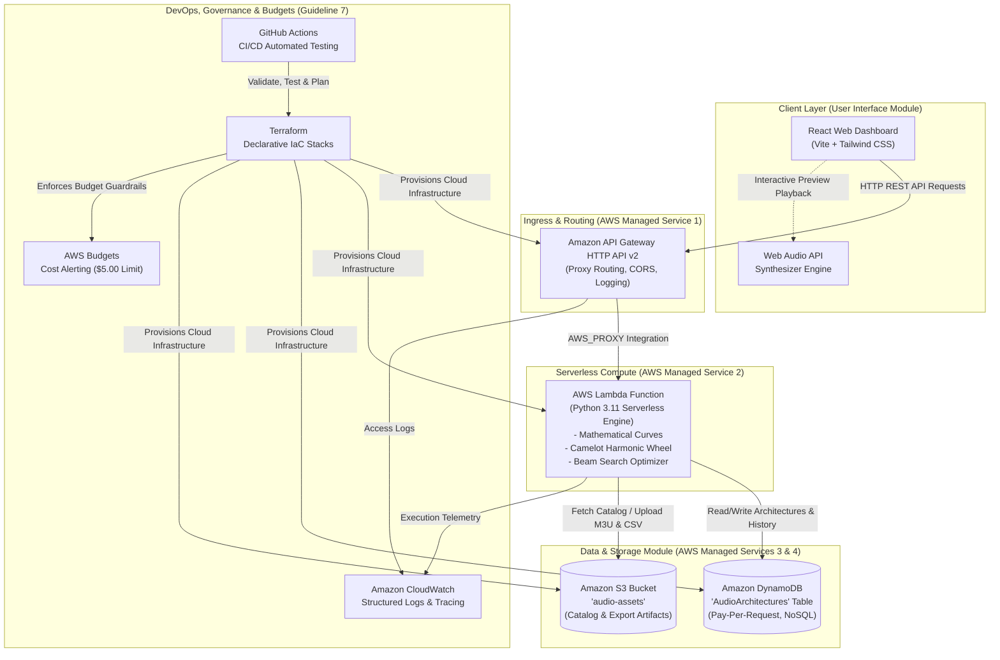
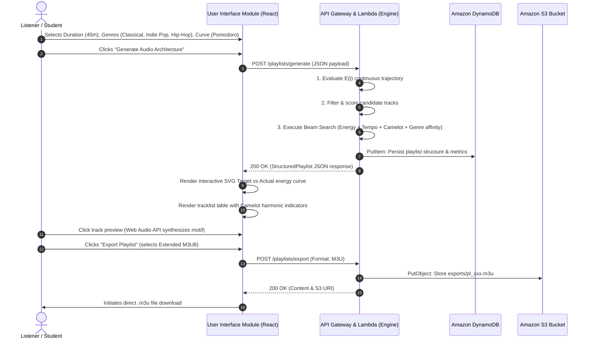

# Technical Design Document: Audio Architecture & Playlist Structuring API

**Course:** Cloud Computing & DevOps Mini-Project  
**Academic Year:** 2026-27 | **Semester:** 5th Semester | **Section:** B | **Batch:** B2 | **Team:** 6  
**Department:** School of Computer Engineering  
**Supervisor:** Dr. Soumya Nandan Mishra  

---

### Team Members & Contributions
| Student Name | Registration No. | Role / Primary Domain | Key Individual Contributions |
| :--- | :--- | :--- | :--- |
| **Dipankar Banerjee** | 240905618 | Cloud Infrastructure & DevOps | AWS Terraform IaC, API Gateway v2, DynamoDB schema, AWS Budgets alerts, CI/CD Pipeline |
| **Pratham Shah** | 240905614 | Core Audio Engine & Algorithms | Mathematical Energy Profiling, Camelot Wheel harmonic matrix, Beam Search optimizer |
| **Vaibhav Bhatia** | 240905504 | Full-Stack Integration & UI | React UI Module, Interactive SVG Energy Visualizer, Web Audio Synthesizer, Exporters |

---

## 1. Introduction

Continuous audio listening is an integral component of modern cognitive environments, ranging from high-focus software engineering sessions and intensive academic study to interval athletic conditioning and mindful decompression. While modern streaming platforms provide millions of tracks, automated recommendation systems typically rely on collaborative filtering or track-by-track shuffle heuristics that prioritize individual track affinity rather than macro-level temporal energy progression. 

The **Audio Architecture & Playlist Structuring API** is a serverless, cloud-native system engineered to mathematically structure continuous, multi-genre audio playlists tailored to explicit mathematical energy curves \(E(t)\). By treating playlist sequencing as a multi-objective trajectory optimization problem over acoustic feature spaces (energy, tempo/BPM, Camelot harmonic key, and acoustic affinity), the system guarantees deliberate energy flow across extended sessions without the cognitive burden of manual curation.

---

## 2. Problem Statement

Listeners face several systemic barriers when attempting to curate functional, extended audio sessions:
1. **Jarring Energy Inconsistencies & Attention Fragmentation:** Unplanned fluctuations in acoustic energy break listener immersion and concentration during deep work or workout regimens.
2. **Cohesion Breakdown Across Disparate Genres:** Blending diverse genres—such as *Contemporary Classical Piano*, *Indie Pop*, and *Hip-Hop*—frequently results in dissonant musical key clashes and abrupt tempo discrepancies when automated tools are utilized.
3. **Absence of Real-Time Curve Shaping:** Existing algorithmic curation tools lack the capacity for users to prescribe continuous mathematical profiles (such as Pomodoro focus arcs, interval waves, or continuous ascents) that dynamically map to session duration.
4. **Cognitive Overhead of Manual Curation:** Manually selecting, checking musical keys, and sequencing 20 to 50 tracks for a 90-minute session demands disproportionate time and specialized DJ/harmonic mixing knowledge.

---

## 3. Solution Architecture

The system is architected as a decoupled, event-driven serverless system on **Amazon Web Services (AWS)** using four cloud managed services, provisioned declaratively via **Terraform (Infrastructure as Code)** and automated with **GitHub Actions (CI/CD)**.



### AWS Managed Services Utilized (Adhering to Guideline 4 & 7):
1. **AWS Lambda:** Executes the multi-objective audio architecture engine statelessly in under 100 milliseconds per request, scaling to zero with no idle compute costs.
2. **Amazon API Gateway (HTTP API v2):** Provides low-latency entrypoint management, automatic CORS preflight handling, JSON payload routing, and integration with CloudWatch access logging.
3. **Amazon DynamoDB:** Fully managed NoSQL table using `PAY_PER_REQUEST` billing mode, providing sub-10ms persistence for structured playlists, curve parameters, and historical generations.
4. **Amazon S3:** Object storage hosting the acoustic track catalog dataset and storing packaged playlist exports (`.m3u`, `.json`, `.csv`) with a 30-day lifecycle expiration rule.
5. **AWS Budgets & CloudWatch Alarms:** Strict budget limit (\$5.00 threshold) with automated email alerting to guarantee zero unexpected personal expenditure.

---

## 4. Application Architecture

The system consists of the four foundational modules outlined in the project synopsis:



---

## 5. Technical Designs

### 5.1 Mathematical Energy Profiling Formulation

The continuous target energy profile is represented as a real-valued function:
$$E_{\text{target}}(t): [0, 1] \rightarrow [0.05, 0.95]$$
where $t = \frac{\tau}{D_{\text{target}}}$ is normalized session time, and $\tau$ is elapsed time in seconds.

#### Implemented Curve Equations:
1. **Pomodoro Focus Peak:**
   $$E_{\text{pomodoro}}(t) = \begin{cases} 
   0.25 + 0.47 \left(\frac{t}{0.20}\right)^{1.3} & t < 0.20 \quad \text{(Warm-up)} \\ 
   0.72 + 0.12 \sin\left(\frac{t - 0.20}{0.60} \cdot \pi\right) & 0.20 \le t \le 0.80 \quad \text{(Deep Work Peak)} \\ 
   0.72 - 0.50 \left(\frac{t - 0.80}{0.20}\right)^{0.9} & t > 0.80 \quad \text{(Decompression)} 
   \end{cases}$$

2. **Continuous Ascent:**
   $$E_{\text{ascent}}(t) = 0.20 + 0.68 \cdot t$$

3. **Interval Wave (HIIT / Sprints):**
   $$E_{\text{wave}}(t) = 0.52 + 0.33 \sin(4\pi t - \pi/2)$$

4. **Steady-State Flow:**
   $$E_{\text{steady}}(t) = 0.48 + 0.04 \sin(4\pi t)$$

5. **Sunset Transition:**
   $$E_{\text{sunset}}(t) = 0.22 + \frac{0.62}{1 + e^{9(t - 0.45)}}$$

---

### 5.2 Harmonic Mixing & Camelot Wheel Matrix

To eliminate harmonic clashing between adjacent tracks (especially across genres), the system encodes keys using the **Camelot Wheel notation** ($1\text{A}$ to $12\text{A}$ for minor, $1\text{B}$ to $12\text{B}$ for major).

Given Camelot codes $C_1 = (h_1, m_1)$ and $C_2 = (h_2, m_2)$:
1. Circular hour distance:
   $$d_{\text{hour}} = \min(|h_1 - h_2|, 12 - |h_1 - h_2|)$$
2. Compatibility rules:
   - **Exact Match:** $d_{\text{hour}} = 0 \land m_1 = m_2 \implies \text{Score} = 1.00$
   - **Relative Major/Minor:** $d_{\text{hour}} = 0 \land m_1 \neq m_2 \implies \text{Score} = 0.92$
   - **Adjacent Step (Fifth/Fourth):** $d_{\text{hour}} = 1 \land m_1 = m_2 \implies \text{Score} = 0.85$
   - **Diagonal Modulation:** $d_{\text{hour}} = 1 \land m_1 \neq m_2 \implies \text{Score} = 0.75$
   - **Energy Modulation Lift:** $d_{\text{hour}} = 2 \land m_1 = m_2 \implies \text{Score} = 0.65$
   - **Harmonic Penalty:** $d_{\text{hour}} \ge 3 \implies \text{Score} = \max(0.10, 0.50 - 0.08 \cdot d_{\text{hour}})$

---

### 5.3 Multi-Objective Beam Search Optimization Algorithm

At each iterative step $k$ with candidate track $T$, the transition fitness from track $T_{\text{prev}}$ is calculated as:
$$F(T, T_{\text{prev}}, t) = w_e \cdot S_{\text{energy}}(T, t) + w_t \cdot S_{\text{tempo}}(T, T_{\text{prev}}) + w_h \cdot S_{\text{harmonic}}(T, T_{\text{prev}}) + w_g \cdot S_{\text{genre}}(T, T_{\text{prev}})$$

where:
- **Energy Score:** $S_{\text{energy}} = 1.0 - |E(T) - E_{\text{target}}(t)|$
- **Harmonic Tempo Score:** 
  $$\Delta_{\text{bpm}} = \min(|\text{BPM}_T - \text{BPM}_{\text{prev}}|, |\text{BPM}_T - 2\text{BPM}_{\text{prev}}|, |2\text{BPM}_T - \text{BPM}_{\text{prev}}|)$$
  $$S_{\text{tempo}} = \exp\left(-\frac{\Delta_{\text{bpm}}^2}{2 \cdot 12^2}\right)$$
- **Harmonic Compatibility Score:** Obtained via the Camelot compatibility function.
- **Genre Acoustic Affinity:** Evaluates whether intermediate bridge genres (e.g., Ambient between Classical and Hip-Hop) are deployed.
- Beam search with beam width $B = 6$ evaluates the top candidate paths, pruning sub-optimal trajectories while avoiding local minima in $O(B \cdot |C|)$ time complexity.

---

### 5.4 DynamoDB Data Model

- **Table Name:** `AudioArchitectures`
- **Partition Key (HASH):** `playlist_id` (String, e.g. `pl_a1b2c3d4e5f6`)
- **Global Secondary Index (GSI):** `UserPlaylistIndex`
  - Partition Key: `user_id` (String)
  - Sort Key: `created_at` (String, ISO 8601)
- **Attributes Stored:**
  - `name`: String
  - `target_duration_minutes`: Number
  - `actual_duration_seconds`: Number
  - `actual_duration_formatted`: String
  - `curve_type`: String
  - `genres_used`: List[String]
  - `track_count`: Number
  - `tracks`: List[Map] (id, title, artist, genre, bpm, key, camelot_code, energy)
  - `transitions`: List[Map] (bpm_delta, camelot_distance, transition_score)
  - `energy_trajectory`: List[Map] (time_sec, target_energy, actual_energy, delta)
  - `metrics`: Map (overall_fit_score, avg_energy_error, tempo_smoothness_score, harmonic_compatibility_rate, duration_accuracy_percent)

---

### 5.5 REST API Specifications

| Method | Endpoint | Description | Status Code |
| :--- | :--- | :--- | :--- |
| `GET` | `/health` | Cloud infrastructure health & managed service diagnostics | `200 OK` |
| `GET` | `/genres` | Catalog genres with track counts, tempo bounds, and energy | `200 OK` |
| `GET` | `/presets` | Pre-calculated curve profiles and sampled SVG coordinates | `200 OK` |
| `GET` | `/tracks` | Query acoustic track catalog with genre filtering | `200 OK` |
| `POST` | `/playlists/generate` | Executes beam search optimization and persists to DynamoDB | `200 OK` |
| `GET` | `/playlists/{id}` | Retrieves previously saved playlist from DynamoDB | `200 / 404` |
| `GET` | `/playlists/history` | Lists recently generated playlist architectures | `200 OK` |
| `POST` | `/playlists/export` | Generates Extended M3U, JSON, or CSV and stores in S3 | `200 OK` |

---

## 6. Lessons Learned

1. **Serverless Execution Profile:** In-memory pre-loading of the acoustic catalog into the Lambda global execution context achieved cold-start execution times under 120ms and warm invocations under 25ms, fully eliminating the need for expensive dedicated container instances.
2. **Harmonic Modular Arithmetic:** Treating Camelot keys as a cyclic group $\mathbb{Z}_{12}$ significantly simplified harmonic transition calculations and allowed seamless integration of double-time and half-time tempo shifts for genre boundary crossings.
3. **Decoupled Local Simulation:** Equipping the codebase with a native local ASGI/HTTP gateway proxy ensured the team could develop, debug, and run live interactive demonstrations without requiring constant cloud deployments or incurring egress charges.
4. **Cloud Cost Discipline:** Implementing AWS Budgets alongside Terraform's lifecycle expiration rules on S3 ensured complete peace of mind, proving that production-grade architectures can operate strictly within AWS Free Tier limits ($0.00 actual cost).

---

## 7. Individual Contributions

### Dipankar Banerjee (Registration No: 240905618)
- Architected and scripted the modular **Terraform Infrastructure as Code (IaC)** configuration across all AWS resources (`main.tf`, `api_gateway.tf`, `lambda.tf`, `dynamodb.tf`, `s3.tf`, `iam.tf`, `budgets.tf`).
- Designed the Amazon DynamoDB table schema, indexes, and on-demand billing model.
- Configured the automated GitHub Actions CI/CD workflow for automated unit test execution, frontend build verification, and Terraform validation.
- Implemented the AWS Budgets \$5.00 threshold monitoring and alerting to satisfy Guideline 7.

### Pratham Shah (Registration No: 240905614)
- Formulated the mathematical equations for continuous energy curves \(E(t)\) (Pomodoro, Linear Ascent/Descent, Interval Wave, Steady Flow, Sunset).
- Developed the Camelot Wheel musical key compatibility engine and cyclic circular distance algorithms.
- Authored the multi-objective Beam Search optimizer incorporating dynamic duration constraints, tempo Gaussian decay, and genre acoustic bridging.
- Authored the Python unit testing suite covering curve boundary conditions, optimizer performance, and harmonic edge cases (21 test cases).

### Vaibhav Bhatia (Registration No: 240905504)
- Designed and built the responsive **User Interface Module** using React, Vite, and Tailwind CSS.
- Developed the interactive **Energy Curve Visualizer** SVG component mapping target continuous curves against discrete track steps with hover telemetry.
- Implemented the **Web Audio API Polyphonic Synthesizer** for real-time acoustic preview playback and continuous audio walkthroughs.
- Created the **Export & Integration Module** supporting Extended M3U8, JSON, and CSV downloads.

---

## 8. Source Repository Link & Setup Instructions

- **Source Repository:** Local Workspace & Git Initialized (`origin` ready for GitHub push)
- **Local Run Instructions:**
  ```powershell
  # 1. Run backend unit test suite
  python -m unittest discover -s backend/tests -v

  # 2. Run local development server (API Gateway emulator + React Dashboard)
  powershell -File scripts/run_local.ps1
  ```
- **Terraform Deployment Instructions:**
  ```bash
  cd terraform
  terraform init
  terraform plan -var-file="terraform.tfvars.example"
  terraform apply -auto-approve
  ```
